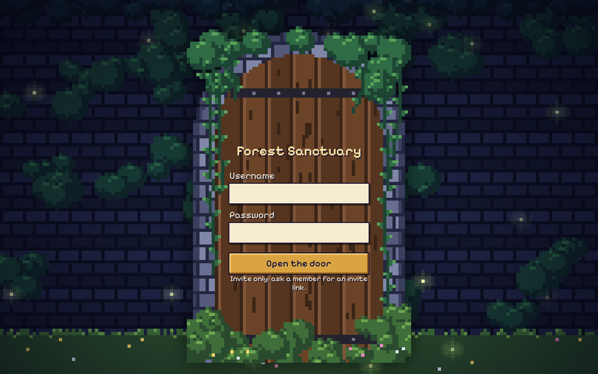
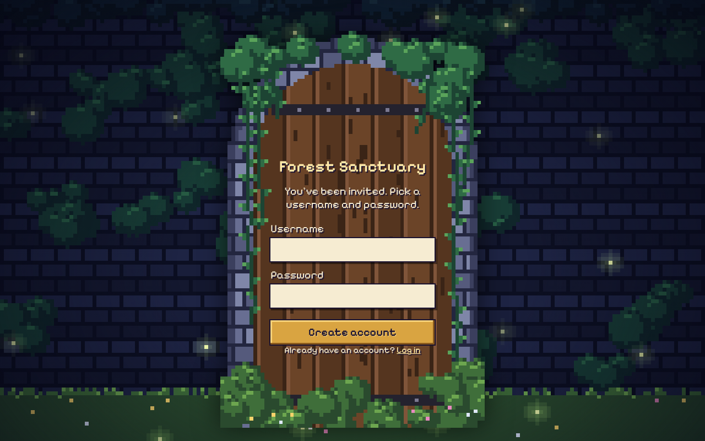
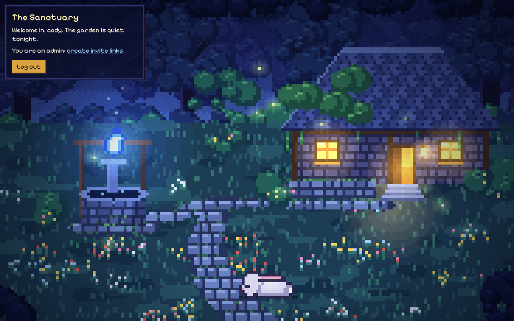
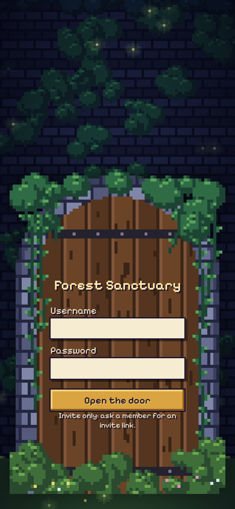
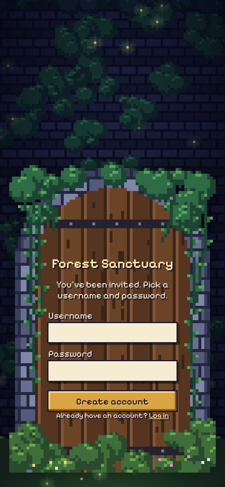
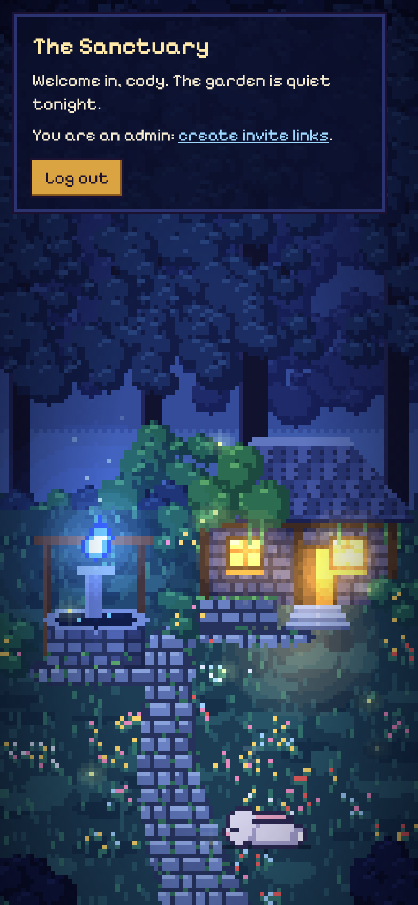

# ♡ forest sanctuary ♡

☾ a tiny invite-only hideaway behind an overgrown pixel-art door

✦ built to learn login, databases, cookies, sessions + deployment

<p align="center">
  
</p>

୨୧ ───────────── ୨୧

## what's inside ✧

- **the door** — log in on an ivy-covered wooden door, with fireflies drifting past
- **invite-only sign-up** — no invite link, no key. each link works once and expires in 7 days
- **the sanctuary** — a members-only night garden with a glowing well, a cottage and a sleeping bunny
- **admin invites** — the first account is the admin and can make invite links for friends
- **all pixel art drawn by code** — no image files, just tiny canvases scaled up crisp

## peek inside ✧

<p align="center">
  
  
</p>

<p align="center">
  
  
  
</p>

୨୧ ───────────── ୨୧

## quick start ✧

you need [Node.js](https://nodejs.org) 22 or newer.

```bash
npm install            # get the libraries
cp .env.example .env   # make your own settings file
npm run dev            # start it at http://localhost:3000
```

then open `.env` and set `SESSION_SECRET` to a long random string. this prints one:

```bash
node -e "console.log(require('crypto').randomBytes(32).toString('hex'))"
```

sign-up is invite only, so make the first invite yourself:

```bash
npm run invite
```

open the link it prints, make your account (you're the admin ♡) and you'll land in the Sanctuary. from there, **create invite links** makes links for friends.

## deploying ✧

it runs for **$0**, no credit card:

- **[Render](https://render.com)** (free web service) runs the app straight from this repo, using `render.yaml`
- **[Turso](https://turso.tech)** (free plan) keeps the database, since free servers forget their files

the free site naps after 15 quiet minutes and takes about a minute to wake up, so tell friends to be patient ☾ the full step-by-step is in [docs/LEARNING.md](docs/LEARNING.md#deploying-to-render).

## built with ✧

Node.js · Express · SQLite / libSQL (Turso) · bcrypt · express-session · plain HTML, CSS + canvas

## what i learned ✧

each step was its own pull request:

1. sign-up + login with hashed passwords (bcrypt)
2. sessions + cookies, so the site remembers you
3. invite codes, admins + rate limiting
4. deployment on free hosting
5. the pixel-art forest look

the long explanations (how cookies really work, why passwords are hashed, transactions, proxies, how the art is drawn) live in **[docs/LEARNING.md](docs/LEARNING.md)** ✧

♡
